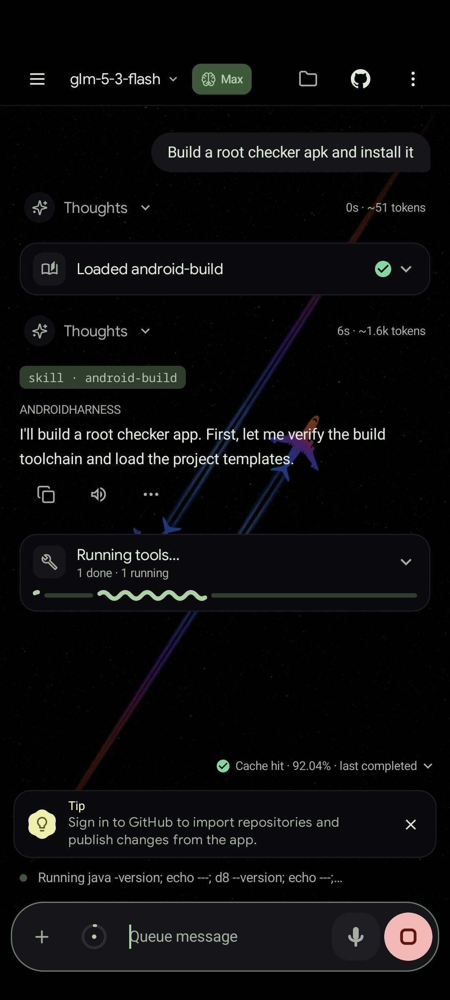
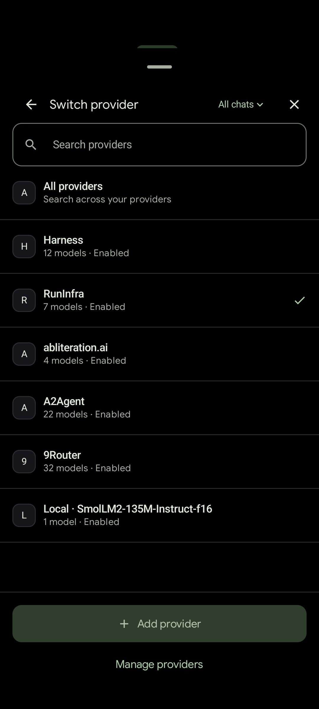
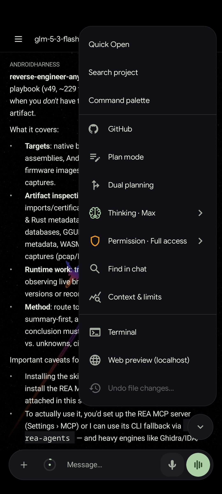
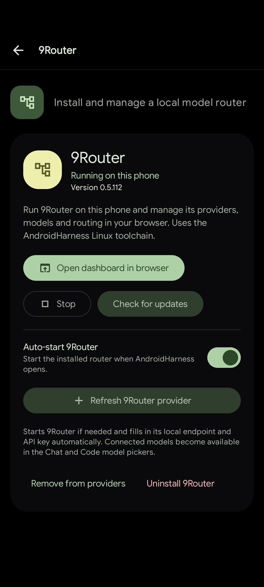
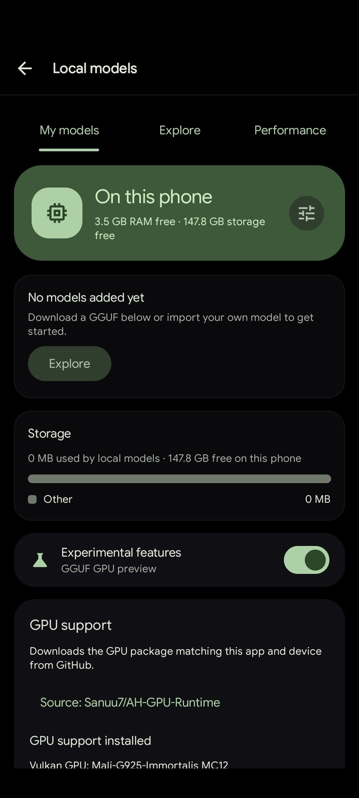
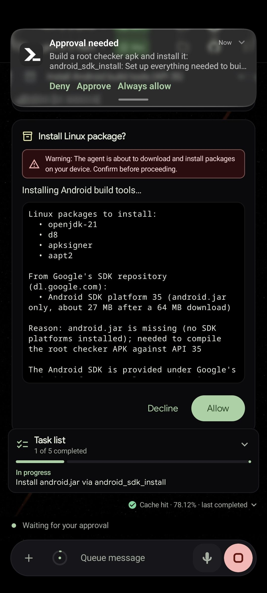

<div align="center">


# HMXHARNESS

**An AI coding agent and chat assistant that runs on your Android phone.**

No PC required. No root required.

<p>
  <a href="https://github.com/HMXPANEL/HMXHARNESS/releases/latest"></a>

## Introduction

HMXHARNESS is a native Android application for working on real software projects from a phone. It combines a coding agent, a general chat assistant, a workspace file manager, a code editor, a Linux shell, Git and GitHub tools, and multiple model providers in one app.

The app is Android-first. It is not a thin web wrapper and it does not need a desktop host. Agent runs, file edits, shell commands, repository operations and local model inference all execute on the device. Cloud models and GitHub require a network connection.

HMXHARNESS is an independently maintained project derived from the MIT-licensed AndroidHarness codebase. See [Attribution and upstream](#attribution-and-upstream).

## Project overview

The app has two working modes:

- **Code** is the agent. It works inside one or more project folders and can read and edit files, run shell commands, use Git, run tests, drive a browser, and publish changes to GitHub.
- **Chat** is for questions, research, writing and planning. It uses read-only tools and can hand a conversation over to Code when the work becomes a project.

Both modes share conversations, memory, voice input and output, model routing, permissions, and the same Material 3 Expressive interface with the Liquid Glass rendering system.

Core ideas:

- Everything important is visible. Tool calls, file diffs, command output and verification results appear as cards in the conversation.
- Destructive or privileged actions ask for approval. Workspace boundaries, shell policy and secret redaction are enforced in the agent layer.
- The app degrades gracefully. Shell access, rendering quality and model choice adapt to the device instead of assuming a flagship phone.
- Credentials stay on the device. Provider keys and GitHub tokens use Keystore-backed encrypted storage.

## Main features

A complete reference is in [FEATURES.md](FEATURES.md).

### Code agent

- Streaming conversations with thinking blocks, tool cards, file diffs and verification cards.
- Workspaces backed by real folders, grouped into projects that can be edited or read only.
- Plan mode, dual planning, subagents, saved message queues and resumable runs.
- Workspace file manager, tabbed code editor, search and replace, and an offline repository map.
- Side-by-side diffs, per-chat change tracking, undo, and a Build & Test dashboard.
- Scheduled automations that run prompts on demand, hourly or daily.

### Shell and device access

- Privileged commands through Shizuku, Wireless ADB pairing or root, when available.
- A workspace Linux toolchain with bash, Git, Python and Node, installed from inside the app.
- A toybox fallback so the app still works before any toolchain is installed.
- Shell policy, command approval, output limits and secret redaction.
- Phone control tools for reminders, alarms, timers and other approved actions.

### Chat and research

- Web research across multiple search providers, with page reading, citations and claim checks.
- Rich answers with tables, charts, diagrams and interactive previews.
- Photo attachments, a single attachment tray and a full-screen gallery.
- Personal chat agents with their own instructions, model, tools and knowledge files.
- Shared memory, saved answers, reminders, and voice input and output.

### Models and providers

- A built-in keyless provider to start without an account.
- ChatGPT accounts, Anthropic, Google Gemini, and any OpenAI-compatible endpoint.
- Multiple API keys per provider, fallback chains, proxies, custom headers and key testing.
- On-device GGUF models with optional GPU acceleration where the device supports it.
- 9Router integration for local model routing.
- Voice providers including free Edge speech, Groq, OpenAI, ElevenLabs, Deepgram, Cartesia and AssemblyAI.

### GitHub

- GitHub OAuth App **Device Flow** sign-in from Connected Accounts or Settings → GitHub.
- A personal access token option for builds without an OAuth Client ID or for users who prefer tokens.
- Repository import, private repository access, commit and push, and pull requests from the app.
- Encrypted token storage and redaction in logs and error messages.
- A dedicated permission explanation in [GitHub authentication setup](#github-authentication-setup).

### Interface

- Material 3 Expressive components with the HMXHARNESS Liquid Glass material.
- Light, Dark and System appearance, persisted across launches and navigation.
- Adaptive glass rendering: the same visual identity on low, mid and high capability devices, with lower shader and blur cost on weaker hardware.
- Responsive layouts, keyboard shortcuts, custom palettes, a background canvas, and haptic feedback.
- Twenty-one app languages, with English as the source of truth and graceful fallback for missing translations.

## Screenshots

<p align="center">
  
  
  
  
  
</p>
<p align="center">
  
  
  
  
  
</p>

These are project screenshots stored in the repository. Cloud-emulator visual QA captures are produced by the [Visual QA workflow](.github/workflows/android-visual-qa.yml) and uploaded as workflow artifacts; they are not committed as marketing images.

## Architecture overview

HMXHARNESS is a single-module Android app (`:app`) with one optional Play dynamic feature (`:local_gpu`). It follows a layered structure:

```text
UI (Jetpack Compose, Material 3 Expressive, Liquid Glass)
  └── ViewModels and UI state
        └── AppContainer composition root
              ├── Agent loop, tools, skills, permissions
              ├── LLM providers, routing and fallback chains
              ├── Workspaces, editor, terminal and Git
              ├── Room database, DataStore and encrypted key storage
              ├── GitHub, MCP, browser, plugins and automation
              └── Linux environment, Shizuku, ADB and native bridges
```

Important boundaries:

- **`ui/`** contains Compose screens and shared components. It does not perform network or database work directly.
- **`agent/`, `tools/`, `llm/`, `workspace/`, `github/`** contain the engine. Tool execution is policy-checked before it touches the device or a workspace.
- **`data/`** owns Room entities and DAOs, settings, backups and encrypted credentials.
- **`terminal/` and `local/`** bridge to the on-device Linux toolchain and native libraries.
- **`AppContainer`** in `HarnessApp.kt` wires the singletons once per process, which keeps feature dependencies explicit and testable.

The UI uses Liquid Glass as a rendering layer, not as a separate navigation system. Glass surfaces sample one shared ambient backdrop so multiple panels never stack independent blurs. Rendering capability is detected once per process and exposed through composition locals; components keep the same colors, corner radii, borders and layout on every tier.

## Technology stack

The following versions are the ones declared in the repository at the time of writing:

| Area | Technology |
| --- | --- |
| Language | Kotlin 2.4.10 |
| Build | Gradle wrapper, Android Gradle Plugin 9.3.1, Kotlin DSL |
| UI | Jetpack Compose, Compose BOM 2026.08.00, Material 3 Expressive 1.5.0-alpha26, Material Icons Extended |
| Navigation | Navigation Compose 2.9.8 |
| State | Kotlin Coroutines 1.10.2, StateFlow, Lifecycle Compose 2.9.4 |
| Persistence | Room 2.8.4, DataStore Preferences 1.2.1, WorkManager 2.10.5 |
| Networking | OkHttp 4.12.0, kotlinx.serialization JSON 1.9.0 |
| Security | AndroidX Security Crypto 1.1.0 (`EncryptedSharedPreferences`, Android Keystore), Biometric 1.2.0 |
| Device access | Shizuku 13.1.5, libsu 6.0.0, Dhizuku API 2.6.0, Wireless ADB |
| Editor | sora-editor 0.23.6 |
| Glass rendering | kyant0 Backdrop 2.0.1, PrismalAGSL 1.0.7 |
| Native | C++ with CMake, NDK 27.2.12479018 |
| Scripting | JavaScriptEngine 1.1.0, CEL 0.14.0 |
| Android | minSdk 26 (Android 8.0), targetSdk 36, compileSdk 37 |
| Tests | JUnit 4, AndroidX Test, Compose UI instrumentation tests |

No analytics or advertising SDK is included. Provider traffic goes directly from the device to the endpoint you configure.

## Installation

### Install a build

1. Download the latest APK from [GitHub Releases](https://github.com/HMXPANEL/HMXHARNESS/releases/latest), or install from [Google Play](https://play.google.com/store/apps/details?id=com.hmx.harness).
2. Allow installation from your browser or file manager when Android asks.
3. Open HMXHARNESS and grant storage access when prompted. Android 11 and newer need **All files access** so shell and file tools can use real workspace paths.
4. Pick a model in Settings. The built-in provider works without a key; cloud providers need their own API key.
5. Optional: install [Shizuku](https://github.com/RikkaApps/Shizuku), pair Wireless ADB, or install the Linux environment in **Settings → Terminal & device** for full shell access. Root is optional and never required.

### Build from source

Requirements:

- JDK 21 (the CI toolchain uses Temurin 21).
- Android SDK with platform 37.
- The pinned NDK `27.2.12479018` for native code. Without it, Gradle configures the app without native libraries; the Kotlin/Compose app still builds.

```bash
git clone https://github.com/HMXPANEL/HMXHARNESS.git
cd HMXHARNESS
./gradlew :app:assembleDebug
```

The debug APK is written to `app/build/outputs/apk/debug/app-debug.apk`. Debug builds use the `com.hmx.harness.debug` application ID, so they can be installed next to a release build.

For a release APK:

```bash
./gradlew :app:assembleRelease
```

Release builds are minified. The current public alpha signs release APKs with the debug keystore so they install without a private signing key. Replace that signing configuration before distributing through a store.

Run unit tests and lint:

```bash
./gradlew :app:testDebugUnitTest
./gradlew :app:lintDebug
```

If your machine cannot run Android builds, use the cloud workflows below. The project is developed and verified with GitHub Actions, and no local Gradle build is required to contribute documentation or review CI results.

## GitHub Actions build instructions

Three workflows build and verify the project:

| Workflow | Trigger | Purpose |
| --- | --- | --- |
| [`android-ci.yml`](.github/workflows/android-ci.yml) | Push to `main` or `feature/**`, pull requests, manual | Unit tests, Android lint, debug and release APKs |
| [`android-release.yml`](.github/workflows/android-release.yml) | Tags matching `v*`, manual | Release APK artifact |
| [`android-visual-qa.yml`](.github/workflows/android-visual-qa.yml) | Manual (and selected feature branches) | Cloud-emulator screenshots and measured performance profiles |

To run a build:

1. Open the **Actions** tab.
2. Select **HMXHARNESS Android CI**.
3. Choose **Run workflow**, pick a branch, and start it.
4. Open the completed run and download the `hmxharness-apks` artifact.

The Visual QA workflow accepts `mode` (`screens`, `performance`, `both`) and, for screenshots, `screen` (a single category or `all`). Each capture runs on a fresh cloud emulator; the workflow uploads per-screen PNGs and a combined artifact.

### OAuth Client ID in CI

The workflows read `HMX_GITHUB_CLIENT_ID` from the repository **variable**, or from an existing repository **secret** with the same name, and write it into the ignored `local.properties` before Gradle starts. A GitHub OAuth App Client ID is public by design; it is not a real secret and no token is printed. If neither is set, the build still succeeds and the app shows that GitHub sign-in is unavailable in that build, while personal access token sign-in remains usable.

Never add a Client Secret, private key, access token or keystore password to this workflow. Device Flow does not use them.

## GitHub authentication setup

HMXHARNESS uses a **GitHub OAuth App with Device Flow**. It does not use a client secret, a private key, or an authentication backend.

### What the app requests

| Item | Value |
| --- | --- |
| OAuth application type | GitHub OAuth App (not a GitHub App) |
| Flow | Device Flow (`/login/device/code` then `/login/oauth/access_token`) |
| Client secret | Not used |
| Scopes | `repo` and `offline_access`; `workflow` only when the user enables workflow editing |
| Token storage | `EncryptedSharedPreferences` wrapped by an Android Keystore `AES256_GCM` master key |
| Token logging | Never logged; error messages redact tokens and remote credentials |

`repo` is deliberately requested because the same connection imports private repositories and publishes commits or pull requests. Identity alone would only need `read:user`; HMXHARNESS does more than identity with this connection. If you only want to try the app without granting repository access, use a personal access token with the narrowest scope that fits your work.

### Create the OAuth App

1. Open GitHub **Settings → Developer settings → OAuth Apps → New OAuth App**.
2. Give it a name and any placeholder homepage URL. Device Flow does not use a redirect callback, so no callback URL is required for this flow.
3. Create the app.
4. Open the app settings and enable **Device Flow**.
5. Copy the **Client ID**. Do not create or store a Client Secret for HMXHARNESS.

### Configure the build

For GitHub Actions:

1. Open the repository **Settings → Secrets and variables → Actions → Variables**.
2. Create `HMX_GITHUB_CLIENT_ID` with the OAuth App Client ID. A repository variable is the recommended place; an existing secret with the same name is also accepted for compatibility.
3. Run a workflow. The build injects the value into `BuildConfig.GITHUB_CLIENT_ID`.

For a local build, add the Client ID to the gitignored `local.properties`:

```properties
GITHUB_CLIENT_ID=your_public_client_id
```

An environment variable `HMX_GITHUB_CLIENT_ID` is also accepted. The value is validated as an alphanumeric string and never committed.

### Connect and disconnect

1. Open **Settings → Connected accounts**.
2. Tap **Continue with GitHub**.
3. The app displays a short user code and the GitHub verification URL.
4. Copy the code, open GitHub, approve the request, and return to the app.
5. The app polls at the interval GitHub returns, handles `authorization_pending`, `slow_down`, `expired_token` and `access_denied`, then shows the connected account and avatar.

**Disconnect GitHub** clears the saved token and login from encrypted storage after a confirmation. Reconnect starts a new Device Flow and replaces the saved connection. Cancelling during the flow never overwrites an existing valid credential.

Device Flow is also available from **Settings → GitHub** alongside the personal access token option, repository import, commit and push, and pull request actions.

### Testing status

The Device Flow state machine has unit tests that run against a local HTTP server: code request, pending and `slow_down` polling, identity verification, token refresh, cancellation, expiry, declined authorization, PAT fallback and redaction. These tests do not prove a live GitHub authorization. A real end-to-end authorization requires a human to approve the code on github.com and is therefore performed manually with the configured OAuth App.

## Configuration

- **Providers and models:** Settings → Models & providers. Add keys, choose models, configure fallbacks, proxies and headers.
- **Workspaces:** create a project folder with Storage Access Framework or point at an existing folder. Workspaces can be edited or read only.
- **Local environment:** Settings → Terminal & device installs the Linux toolchain and configures Shizuku, Wireless ADB or root.
- **Project configuration:** a workspace can include `harness.json` for project-specific agent settings. See the [configuration guide](docs/configuration/README.md) and [JSON schema](docs/harness.schema.json).
- **Plugins and skills:** Settings → Plugins and Settings → Skills. Plugin installation never runs npm lifecycle scripts.
- **Backups:** Settings → Backups exports encrypted settings or chat data. API keys are included only when explicitly selected.

## Project structure

```text
HMXHARNESS/
├── app/
│   ├── src/main/java/com/hmx/harness/
│   │   ├── agent/         Agent loop, planning, context and verification
│   │   ├── tools/         Tool implementations, policy and MCP
│   │   ├── llm/           Providers, model catalog, routing and fallback
│   │   ├── workspace/     Projects, files, editor state and changes
│   │   ├── github/        Device Flow, repositories, pull requests
│   │   ├── data/          Room, settings, backups, encrypted storage
│   │   ├── terminal/      Linux environment and shell bridges
│   │   ├── local/         On-device model and GPU integration
│   │   ├── ui/            Compose screens, components and design system
│   │   ├── browser/       In-app browser and page extraction
│   │   ├── plugins/       Plugin manager and runtime
│   │   ├── skills/        Agent skills and playbooks
│   │   ├── automation/    Scheduled and triggered runs
│   │   ├── reminders/     Alarms, timers and reminders
│   │   └── HarnessApp.kt  Application and AppContainer
│   ├── src/main/cpp/      Native bridges, ADB and local runtime code
│   ├── src/debug/         Debug-only screenshot and performance hosts
│   ├── src/test/          JVM unit tests
│   └── src/androidTest/   Instrumented UI and device tests
├── local_gpu/             Optional Play dynamic feature
├── docs/                  Architecture, configuration and QA reports
├── scripts/               Cloud QA capture and smoke-test scripts
├── .github/workflows/     CI, release and visual QA
├── FEATURES.md            Complete feature reference
├── PRIVACY.md             Privacy policy
├── SECURITY.md            Security policy
└── CHANGELOG.md           Release notes
```

## Permissions

HMXHARNESS requests permissions only for features that exist in the app. Some are optional and can be denied; the app explains the effect.

| Permission | Why it is requested |
| --- | --- |
| `INTERNET`, `ACCESS_NETWORK_STATE` | Model providers, GitHub, web research, updates |
| `POST_NOTIFICATIONS` | Long-running agent and download notifications |
| `FOREGROUND_SERVICE`, `FOREGROUND_SERVICE_DATA_SYNC`, `FOREGROUND_SERVICE_SPECIAL_USE` | Keep agent runs and transfers alive with a visible notification |
| `WAKE_LOCK`, `RECEIVE_BOOT_COMPLETED` | Resume scheduled work and automations |
| `SCHEDULE_EXACT_ALARM`, `SET_ALARM` | Reminders, alarms and timers requested by the user |
| `REQUEST_IGNORE_BATTERY_OPTIMIZATIONS` | Optional; helps long runs survive aggressive battery management |
| `moe.shizuku.manager.permission.API_V23` | Privileged shell access through Shizuku |
| `REQUEST_INSTALL_PACKAGES` | Install app updates that the user downloads |
| `ACCESS_LOCAL_NETWORK` | Local model servers, 9Router and LAN transfers |
| `RECORD_AUDIO` | Voice input |
| `USE_BIOMETRIC` | Optional app lock |
| `VIBRATE` | Haptic feedback |
| `MANAGE_EXTERNAL_STORAGE` | Optional All files access so shell and file tools can use real paths |

Root, Device Owner and Wireless ADB access are separate opt-in capabilities, not install-time permissions. The agent asks before privileged or destructive actions and records the decision per chat.

## Privacy and security

- **Credentials:** provider API keys, search keys and GitHub tokens are stored with AndroidX Security Crypto, encrypted by an Android Keystore master key. They are not written to plain preferences, logs or source files.
- **GitHub:** Device Flow uses only the public Client ID. No client secret or private key exists in the app or CI. Tokens are sent only to `api.github.com` and are redacted from user-visible errors.
- **Chat traffic:** requests go directly to the provider or endpoint you configure. HMXHARNESS does not proxy model traffic through a project server.
- **Workspace boundary:** the agent is restricted to selected workspaces. File writes are shown as diffs and can be undone from Changes.
- **Shell policy:** commands are classified before execution. Sensitive actions require approval; output is capped and secrets are redacted.
- **Backups:** exported settings and chats are encrypted. Restoring onto a new device requires the passphrase; losing it means the backup cannot be recovered.
- **No analytics:** the app does not include an advertising or analytics SDK.

Read [PRIVACY.md](PRIVACY.md) and [SECURITY.md](SECURITY.md) for the full policies.

## Performance considerations

HMXHARNESS is designed to remain usable on low-end phones, not only flagships.

- **Adaptive Liquid Glass:** the app detects a rendering tier once from platform signals (low-RAM flag, heap budget, CPU cores, OpenGL ES/Vulkan capability and Android version) and adjusts blur radius, refraction layers, specular detail and animation length. Colors, layout, corner radii and component structure stay the same on every tier.
- **One ambient backdrop:** glass surfaces share a single painted backdrop instead of stacking independent full-screen blurs.
- **Static fallbacks:** devices without a usable backdrop shader get the layered-gradient glass path with the same tint and borders.
- **Bounded work:** agent runs stream output, cap tool output, and avoid unbounded recomposition in long conversations.
- **Local models:** GGUF inference depends on the device's CPU, RAM and optional GPU support. The app exposes the detected environment instead of promising a speed.
- **Measured, not assumed:** the debug-only `GlassPerfActivity` scrolls real glass components and records frame intervals, p95 and jank counts. The Visual QA workflow runs it on low, mid and high emulator profiles and uploads the raw measurements.

Visual QA screenshots and performance runs are produced on cloud emulators. Emulator timings are useful for relative comparisons, not as a guarantee for a specific phone. Real-device testing remains part of the roadmap.

## Troubleshooting

**The build fails with a missing NDK.** Install NDK `27.2.12479018` through the Android SDK Manager, or let CI build it. Gradle falls back to a no-native configuration when the NDK is absent.

**GitHub sign-in says it is unavailable.** This build has no `GITHUB_CLIENT_ID`. Set the `HMX_GITHUB_CLIENT_ID` Actions variable (or secret) or add `GITHUB_CLIENT_ID` to `local.properties`, then rebuild. Personal access token sign-in still works.

**GitHub says Device Flow is disabled.** Open the OAuth App settings on GitHub and enable Device Flow. If you cannot, use a personal access token.

**Device Flow is rate limited.** GitHub limits how often a shared OAuth App can issue device codes. Wait and retry, or use a personal access token.

**A repository push fails.** Check the workspace, the remote branch, token permissions and branch protection. HMXHARNESS never force-pushes; if the remote moved ahead, pull or rebase first.

**Shell commands do not run.** Open **Settings → Terminal & device** and check the reported tier. Install the Linux environment, connect Shizuku, pair Wireless ADB, or enable root if available. `/doctor` tests the tool families.

**Files are missing after a reinstall.** Debug and release builds have different application IDs and separate storage. Back up chats and settings before uninstalling.

**The interface feels heavy on an old phone.** Keep the system theme static, reduce a large background image, and avoid several simultaneous agent runs. The rendering tier is detected automatically, but no glass effect can make very old GPUs render like a flagship.

## Roadmap

The roadmap is intentionally short and honest. Items are not promises and may change.

- Complete real-device visual and thermal verification on low-end hardware, in addition to cloud emulators.
- Expand the connected-account experience with more explicit scope and repository selection.
- Continue translation coverage for newer strings.
- Improve repository maps and code intelligence for very large workspaces.
- Refine device capability detection as Android exposes better performance-class APIs.

Completed work is recorded in [CHANGELOG.md](CHANGELOG.md). Feature requests and bug reports are welcome through the issue forms.

## Contributing

Contributions are welcome: bug reports, fixes, tests, translations and documentation.

- Read [CONTRIBUTING.md](CONTRIBUTING.md) for fork, branch, commit, pull request and testing guidance.
- Follow the [Code of Conduct](CODE_OF_CONDUCT.md).
- Report security issues privately as described in [SECURITY.md](SECURITY.md).
- Use the [bug report](.github/ISSUE_TEMPLATE/bug_report.yml) and [feature request](.github/ISSUE_TEMPLATE/feature_request.yml) forms.
- Translations are managed on [POEditor](https://poeditor.com/join/project/ZPbHNa9WWc).

Please do not commit API keys, access tokens, signing keys, `local.properties`, private workspace data or personal device logs.

## License

HMXHARNESS is released under the [MIT License](LICENSE). Third-party libraries and assets remain under their own licenses and notices. The MIT license for this project does not relicense those dependencies.

## Contact and links

- Repository: [github.com/HMXPANEL/HMXHARNESS](https://github.com/HMXPANEL/HMXHARNESS)
- Issues: [github.com/HMXPANEL/HMXHARNESS/issues](https://github.com/HMXPANEL/HMXHARNESS/issues)
- Releases: [github.com/HMXPANEL/HMXHARNESS/releases](https://github.com/HMXPANEL/HMXHARNESS/releases)


