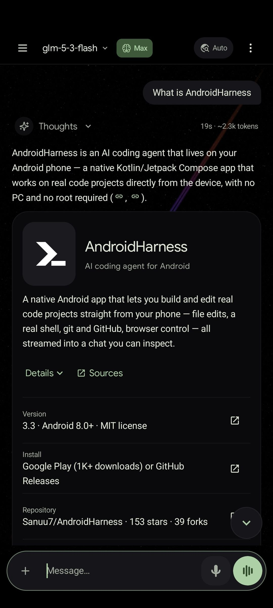
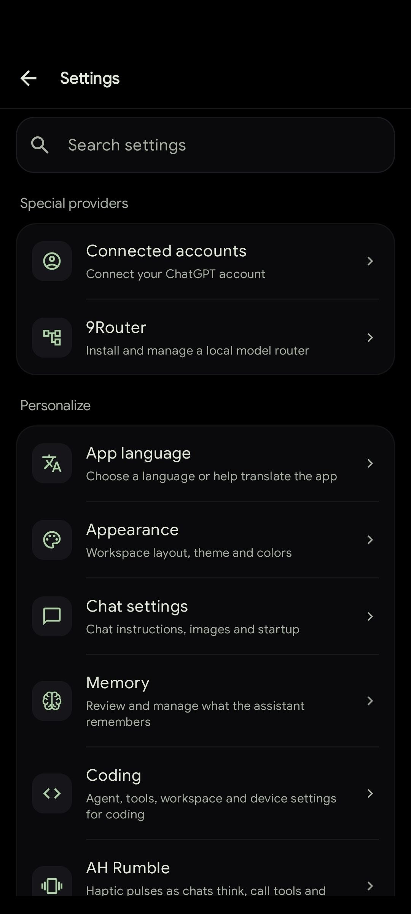
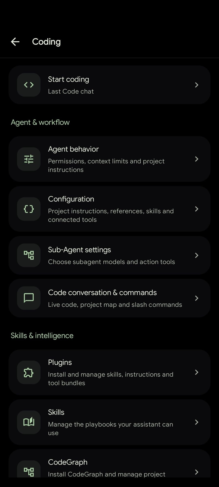
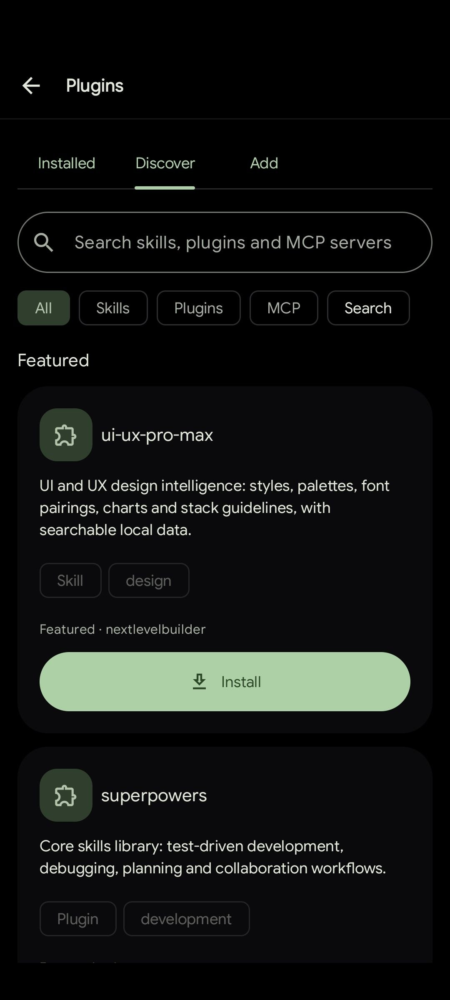

<div align="center">


# HMXHARNESS

**An AI coding agent and chat assistant that runs natively on your Android phone.**

No PC required. No root required.

<p>
  <a href="https://github.com/HMXPANEL/HMXHARNESS/releases/latest"></a>
</p>

</div>

## Contents

- [Overview](#overview)
- [Problem statement](#problem-statement)
- [Target audience](#target-audience)
- [Core features](#core-features)
- [Screenshots](#screenshots)
- [Technology stack](#technology-stack)
- [Architecture overview](#architecture-overview)
- [AI models and providers](#ai-models-and-providers)
- [Local GGUF model support](#local-gguf-model-support)
- [Installation](#installation)
- [Configuration](#configuration)
- [GitHub integration](#github-integration)
- [Cloud build instructions](#cloud-build-instructions)
- [Privacy and security](#privacy-and-security)
- [Known limitations](#known-limitations)
- [Frequently asked questions](#frequently-asked-questions)
- [Roadmap](#roadmap)
- [License and legal attribution](#license-and-legal-attribution)
- [Issues and releases](#issues-and-releases)
- [Acknowledgements](#acknowledgements)

## Overview

HMXHARNESS is a native Android application for working on real software projects from a phone. It brings together a coding agent, a general chat assistant, a workspace file manager, a code editor, a Linux shell, Git and GitHub tools, and multiple AI model providers in one app.

The app is Android-first. It is not a thin web wrapper and it does not need a desktop host. Agent runs, file edits, shell commands, repository operations and local model inference execute on the device. Cloud model providers, web search and GitHub require a network connection.

HMXHARNESS is an independently maintained project derived from the MIT-licensed AndroidHarness codebase. It is **not** a from-scratch rewrite of that codebase; upstream authorship, the MIT copyright notice and third-party licenses are preserved. See [License and legal attribution](#license-and-legal-attribution).

- Application ID: `com.hmx.harness` (debug builds use `com.hmx.harness.debug`)
- Current version: `4.0` (`versionCode` 40)
- Android: `minSdk 26` (Android 8.0), `targetSdk 36`, `compileSdk 37`

## Problem statement

A coding agent normally assumes a laptop: a terminal, a filesystem, an IDE and a stable network. Students, hobbyists and developers who are away from a desk still need to read code, make small changes, run checks and publish a commit.

Existing phone options are usually browsers wrapped around a remote service or chat-only assistants that cannot touch a real project. They cannot offer a workspace, a shell, a diff, Git operations or on-device inference together.

HMXHARNESS addresses that gap by running the agent loop, tools and data on the phone itself, and by connecting to whatever model provider or local model the user configures. It does not claim to replace a desktop IDE; it removes the requirement to have one for a useful subset of work.

## Target audience

| User | Need |
| --- | --- |
| Students and hobby developers without a PC | Work on real repositories from an Android phone. |
| Developers on the move | Read, edit, run checks and push commits without carrying a laptop. |
| Privacy-conscious users | Keep credentials in Keystore-backed storage and optionally run GGUF models on-device. |
| Power users | Terminal, Git, Shizuku/root/Wireless ADB, MCP, plugins and scheduled automations. |

## Core features

A complete reference is in [FEATURES.md](FEATURES.md).

### Code agent

- Streaming conversations with thinking blocks, tool cards, file diffs and verification cards.
- Workspaces backed by real folders, grouped into projects that can be editable or read-only.
- Plan mode restricts the agent to read-only tools; subagents, saved message queues and resumable runs are supported.
- Workspace file manager, tabbed code editor with [sora-editor](https://github.com/Rosemoe/sora-editor), search and replace, and an offline repository map.
- Side-by-side diffs, per-chat change tracking, undo, and a Build & Test dashboard.
- Scheduled automations that run prompts on demand, hourly or daily.

### Shell and device access

- Privileged commands through Shizuku, Wireless ADB pairing or root, when available.
- A workspace Linux toolchain (bash, Git, Python, Node) installed from inside the app, with a toybox fallback.
- Shell policy, command approval, output limits and secret redaction.

### Chat and research

- Web research across multiple search providers, with page reading and citations.
- Rich answers with tables, charts, diagrams and interactive previews.
- Personal chat agents with their own instructions, model, tools and knowledge files.
- Shared memory, saved answers, reminders, and voice input and output.

### Models and providers

- A built-in keyless provider so the app can be tried without an account.
- ChatGPT accounts, Anthropic, Google Gemini, and any OpenAI-compatible endpoint.
- Multiple API keys per provider, fallback chains, proxies, custom headers and key testing.
- On-device GGUF models with optional GPU acceleration where the device supports it.
- 9Router integration for local model routing.
- Voice providers including Edge speech, Groq, OpenAI, ElevenLabs, Deepgram, Cartesia and AssemblyAI.

### GitHub

- GitHub OAuth App **Device Flow** sign-in from Connected Accounts, using only a public Client ID and no client secret.
- A personal access token option for builds without an OAuth Client ID.
- Repository import, private repository access, commit and push, and pull requests from the app.
- Encrypted token storage and redaction in logs and error messages.

### Interface

- Material 3 Expressive components with the HMXHARNESS Liquid Glass material system.
- Light, Dark and System appearance, persisted across launches.
- Adaptive glass rendering with low, mid and high quality tiers selected from device capability.
- Twenty-one translated interface languages with English as the source of truth and graceful fallback.

## Screenshots

These are project screenshots stored in this repository:

<p align="center">
  
  
  
  
  
</p>
<p align="center">
  
  
  
  
  
</p>

Cloud-emulator visual QA captures are produced by the [Visual QA workflow](.github/workflows/android-visual-qa.yml) and uploaded as workflow artifacts; they are not committed as marketing images.

## Technology stack

Versions are those declared in `gradle/libs.versions.toml`, `app/build.gradle.kts` and `gradle/wrapper/gradle-wrapper.properties`.

| Area | Technology |
| --- | --- |
| Language | Kotlin 2.4.10 |
| Build | Gradle wrapper 9.7.0, Android Gradle Plugin 9.3.1, Kotlin DSL, KSP 2.3.11 |
| UI | Jetpack Compose, Compose BOM 2026.08.00, Material 3 Expressive 1.5.0-alpha26, Material Icons Extended |
| Navigation | Navigation Compose 2.9.8 |
| State | Kotlin Coroutines 1.10.2, StateFlow, Lifecycle Compose 2.9.4 |
| Persistence | Room 2.8.4, DataStore Preferences 1.2.1, WorkManager 2.10.5 |
| Networking | OkHttp 4.12.0, kotlinx.serialization JSON 1.9.0, Conscrypt, BouncyCastle, JSch |
| Security | AndroidX Security Crypto 1.1.0 (`EncryptedSharedPreferences`, Android Keystore), Biometric 1.2.0 |
| Device access | Shizuku 13.1.5, libsu 6.0.0, Dhizuku API 2.6.0, Wireless ADB |
| Editor | sora-editor 0.23.6 |
| Glass rendering | kyant0 Backdrop 2.0.1, PrismalAGSL 1.0.7 |
| Native | C++17 with CMake 3.22.1, NDK 27.2.12479018, llama.cpp via CMake `FetchContent` |
| Scripting | Android JavaScriptEngine 1.1.0, CEL 0.14.0 |
| Tests | JUnit 4, AndroidX Test, Compose UI instrumentation |
| CI | GitHub Actions, Temurin JDK 21 |

There is no analytics, advertising or crash-reporting SDK, and no project-owned backend server. Provider requests go directly from the device to the endpoint you configure.

## Architecture overview

HMXHARNESS is a single-module Android app (`:app`) with one optional Play dynamic feature (`:local_gpu`, only included with `-Pdistribution=play`). It follows a layered structure:

```text
UI (Jetpack Compose, Material 3 Expressive, Liquid Glass)
  └── ViewModels and UI state
        └── AppContainer composition root (HarnessApp.kt)
              ├── Agent loop, tools, skills, permissions, verification
              ├── LLM providers, routing and fallback chains
              ├── Workspaces, editor, terminal and Git
              ├── Room database, DataStore and encrypted key storage
              ├── GitHub, MCP, browser, plugins and automation
              └── Linux environment, Shizuku, ADB and native bridges
```

Important boundaries:

- `ui/` contains Compose screens and shared components; it does not perform network or database work directly.
- `agent/`, `tools/`, `llm/`, `workspace/` and `github/` contain the engine. Tool execution is policy-checked before it touches the device or a workspace.
- `data/` owns Room entities and DAOs, settings, backups and encrypted credentials.
- `local/` and `app/src/main/cpp/` bridge to on-device model inference.
- `AppContainer` in `HarnessApp.kt` wires singletons once per process, keeping dependencies explicit and testable.

A more detailed, source-referenced description is in [docs/expo/HMXHARNESS_ARCHITECTURE.md](docs/expo/HMXHARNESS_ARCHITECTURE.md).

## AI models and providers

The application supports four wire protocols plus special providers:

| Provider path | Notes |
| --- | --- |
| OpenAI-compatible (`/chat/completions`) | Default for most custom endpoints |
| OpenAI Responses (`/v1/responses`) | Responses API |
| Anthropic Messages (`/v1/messages`) | Anthropic API |
| Google Gemini (`:streamGenerateContent`) | Gemini API |
| ChatGPT account | Account-based connection |
| Built-in keyless provider | Routes to third-party public gateways; not a model hosted by HMXHARNESS |
| Local GGUF | On-device inference through llama.cpp |
| Fallback and key rotation | Cross-provider fallback chains and multiple keys |

The built-in free option depends on third-party free tiers. It can be rate-limited or withdrawn and is not guaranteed free inference. You can add your own keys in **Settings → Models & providers**; usage is billed by your chosen provider, not by HMXHARNESS.

## Local GGUF model support

- `local/LocalNative.kt` exposes JNI entry points; `app/src/main/cpp/local_model.cpp` and related files implement inference, chat templating and Safetensors-to-GGUF conversion.
- `CMakeLists.txt` fetches llama.cpp, enables dynamic GGML backends and supports Vulkan on `arm64-v8a` and `x86_64`; 32-bit ABIs receive stubs.
- Models run on the device without an API key. They still need a model download, sufficient RAM, and optional GPU support.
- Local model files are parsed by native code; import them only from sources you trust.

## Installation

### Install a build

1. Download an APK from [GitHub Releases](https://github.com/HMXPANEL/HMXHARNESS/releases/latest) or from a successful [Actions run](https://github.com/HMXPANEL/HMXHARNESS/actions).
2. Allow installation from your browser or file manager when Android asks.
3. Open HMXHARNESS and grant storage access when prompted. Android 11+ needs **All files access** for shell and file tools to use real workspace paths.
4. Pick a model in Settings. The built-in keyless provider works without a key; cloud providers need their own key.
5. Optional: install [Shizuku](https://github.com/RikkaApps/Shizuku), pair Wireless ADB, or install the Linux environment in **Settings → Terminal & device**. Root is optional and never required.

The current public builds are **debug-signed release APKs** intended for installable alpha distribution. They are not Play Store ready.

### Build from source

Requirements: JDK 21, Android SDK platform 37, and (for native code) NDK `27.2.12479018`. Without the pinned NDK, Gradle configures the app without native libraries; the Kotlin/Compose app still builds.

```bash
git clone https://github.com/HMXPANEL/HMXHARNESS.git
cd HMXHARNESS
./gradlew :app:assembleDebug
```

The debug APK is written to `app/build/outputs/apk/debug/app-debug.apk` and uses the `com.hmx.harness.debug` application ID, so it can be installed next to a release build.

```bash
./gradlew :app:assembleRelease
./gradlew :app:testDebugUnitTest
./gradlew :app:lintDebug
```

Local Gradle builds are optional: the project is verified on GitHub Actions cloud runners, and no local Android build is required to review CI results or contribute documentation.

## Configuration

- **Providers and models:** Settings → Models & providers. Add keys, choose models, configure fallbacks, proxies and headers.
- **Workspaces:** create a project folder with the Storage Access Framework or point at an existing folder. Workspaces can be editable or read-only.
- **Local environment:** Settings → Terminal & device installs the Linux toolchain and configures Shizuku, Wireless ADB or root.
- **Project configuration:** a workspace can include `harness.json` for project-specific agent settings. See the [configuration guide](docs/configuration/README.md) and [JSON schema](docs/harness.schema.json).
- **Plugins and skills:** Settings → Plugins and Settings → Skills. Plugin installation never runs npm lifecycle scripts.
- **Backups:** Settings → Backups exports encrypted settings or chat data. Credentials are included only when explicitly selected.

## GitHub integration

HMXHARNESS uses a **GitHub OAuth App with Device Flow**. It needs no client secret, private key or authentication backend.

| Item | Value |
| --- | --- |
| OAuth application type | GitHub OAuth App (not a GitHub App) |
| Flow | Device Flow (`/login/device/code`, then `/login/oauth/access_token`) |
| Client secret | Not used |
| Scopes | `repo` and `offline_access`; `workflow` only when workflow editing is enabled |
| Token storage | `EncryptedSharedPreferences` with an Android Keystore `AES256_GCM` master key |
| Token logging | Tokens are not logged; errors redact tokens and remote credentials |

`repo` is requested because the same connection imports private repositories and publishes commits or pull requests. If you only want to try the app without repository access, use a personal access token with the narrowest scope that fits your work.

**Create the OAuth App:** GitHub → Settings → Developer settings → OAuth Apps → New OAuth App. Give it a name and any placeholder homepage URL (Device Flow needs no callback URL), create it, enable **Device Flow**, and copy the **Client ID**. Do not create or store a Client Secret for HMXHARNESS.

**Configure a cloud build:** repository Settings → Secrets and variables → Actions → **Variables** → create `HMX_GITHUB_CLIENT_ID` with the public Client ID. An existing secret with the same name is accepted for compatibility. The workflow writes the value into the gitignored `local.properties` before Gradle runs, and Gradle exposes it as `BuildConfig.GITHUB_CLIENT_ID`. The value is never printed. Never add a Client Secret, private key, access token or keystore password to the workflow.

**Configure a local build:** add the public Client ID to the gitignored `local.properties`:

```properties
GITHUB_CLIENT_ID=your_public_client_id
```

An environment variable `HMX_GITHUB_CLIENT_ID` is also accepted. The value is validated as an alphanumeric string and must never be committed.

**Connect:** Settings → Connected accounts → Continue with GitHub. The app shows a short user code and verification URL; approve it on github.com and return to the app. The app handles `authorization_pending`, `slow_down`, `expired_token` and `access_denied`. Disconnecting clears the saved credential after confirmation.

The Device Flow state machine has unit tests against a local HTTP server. A live authorization requires a human to approve the code and is therefore not part of CI.

## Cloud build instructions

| Workflow | Trigger | Purpose |
| --- | --- | --- |
| [`android-ci.yml`](.github/workflows/android-ci.yml) | Push to `main` or `feature/**`, pull requests, manual | Unit tests, Android lint, debug and release APKs, artifact upload |
| [`android-release.yml`](.github/workflows/android-release.yml) | Tags matching `v*`, manual | Release APK artifact |
| [`android-visual-qa.yml`](.github/workflows/android-visual-qa.yml) | Manual, selected feature branches | Cloud-emulator screenshots and performance profiles |
| [`lint-baseline.yml`](.github/workflows/lint-baseline.yml) | Manual | Regenerate the inherited lint baseline |

To run a build: open the **Actions** tab, select **HMXHARNESS Android CI**, choose **Run workflow**, pick a branch, start it, then download the `hmxharness-apks` artifact from the completed run.

Reference evidence: run [`45338701934`](https://github.com/HMXPANEL/HMXHARNESS/actions/runs/45338701934) on `main` completed successfully, including unit tests, lint, both APKs and artifact upload. The Visual QA workflow accepts `mode` (`screens`, `performance`, `both`) and `screen`.

## Privacy and security

- **Credentials:** provider keys, search keys and GitHub tokens use AndroidX Security Crypto with an Android Keystore master key. They are not written to plain preferences, logs or source files.
- **GitHub:** Device Flow uses only the public Client ID. No client secret or private key exists in the app or CI. Tokens are sent to GitHub and redacted from user-visible errors.
- **Chat traffic:** requests go directly to the provider or endpoint you configure. HMXHARNESS does not proxy model traffic through a project server. When cloud providers are used, prompts and selected context (which may include file contents and command output) leave the device.
- **Workspace boundary:** the agent is restricted to selected workspaces. File writes are shown as diffs and can be undone from Changes.
- **Shell policy:** commands are classified before execution. Sensitive actions require approval; output is capped and secrets are redacted.
- **Backups:** exported settings and chats are encrypted. Losing the passphrase means the backup cannot be recovered.
- **No analytics:** the app does not include an advertising or analytics SDK.

Read [PRIVACY.md](PRIVACY.md) for the data-handling policy and [SECURITY.md](SECURITY.md) for the security policy and known findings.

## Known limitations

- Release APKs are signed with the Android **debug** certificate for alpha distribution; they are not Play Store ready.
- Device-dependent behaviour (shell tiers, local inference, voice, Telegram, browser automation) is implemented and compile-tested but was not verified on physical hardware in this environment.
- Live GitHub Device Flow approval requires a human and is not exercised by CI.
- Instrumentation tests exist but are not wired into the CI pipeline; the emulator workflow is used for visual QA.
- The `HMX_GITHUB_CLIENT_ID` repository variable is not configured in this repository at present, so Device Flow sign-in is disabled in current builds; personal access token sign-in still works.
- Cloud providers, free gateways and keyless search are third-party services with no service-level guarantee from HMXHARNESS.
- Real-device performance and frame timing are not measured. Emulator results are relative indicators only.
- The repository is a fresh migration; earlier Git history and authorship records were not carried over, and upstream attribution is retained in documentation and license notices instead.

## Frequently asked questions

**Does HMXHARNESS need root?** No. Root is optional; Shizuku, Wireless ADB or the toybox fallback can be used instead.

**Does it train its own AI model?** No. There is no training code. Cloud models come from configured providers; local models use llama.cpp with GGUF files.

**Is it offline?** Only optional local GGUF inference is offline. Cloud models, web search and GitHub need a network connection, and local models need an initial download.

**Why is Device Flow unavailable in my build?** The build has no `GITHUB_CLIENT_ID`. Set the `HMX_GITHUB_CLIENT_ID` Actions variable or add `GITHUB_CLIENT_ID` to `local.properties`, then rebuild. PAT sign-in still works.

**Why do debug and release builds not share data?** They use different application IDs (`com.hmx.harness.debug` and `com.hmx.harness`) and therefore separate storage. Back up chats and settings before uninstalling.

**Where do I report a problem?** Use the [issue forms](https://github.com/HMXPANEL/HMXHARNESS/issues/new/choose). Report security issues privately as described in [SECURITY.md](SECURITY.md).

## Roadmap

This roadmap is intentionally short and is not a set of promises.

- Real-device visual and thermal verification on low-end hardware, in addition to cloud emulators.
- A dedicated release signing configuration before any store distribution.
- Expanded connected-account controls for scope and repository selection.
- Continued translation coverage for newer strings.
- Improved repository maps and code intelligence for very large workspaces.

Completed work is recorded in [CHANGELOG.md](CHANGELOG.md).

## License and legal attribution

HMXHARNESS is released under the [MIT License](LICENSE). The complete original MIT permission notice and disclaimer are preserved verbatim, including `Copyright (c) 2026 Sanuu7`.

- **Original upstream authorship:** AndroidHarness by Sanuu7, MIT-licensed. HMXHARNESS is an independently maintained derivative; the upstream agent engine, tools and UI foundation were inherited and extended, not written from scratch by this project.
- **HMXHARNESS project identity:** the current product name, branding, cloud CI configuration, verification gate, approval policy additions and documentation.
- **Third-party components:** llama.cpp, Shizuku, libsu, Dhizuku, sora-editor, PrismalAGSL, kyant0 Backdrop, JSch, BouncyCastle, Conscrypt and others remain under their own licenses. Their notices are bundled under `app/src/main/assets/licenses/`, `app/src/main/assets/editor-tools/LICENSES.txt` and the relevant asset directories.

The MIT license for this project does not relicense those dependencies. Historical commit hashes from the previous repository are not reproduced in this fresh repository; attribution is retained through the license, notices and this section.

## Issues and releases

- Repository: [github.com/HMXPANEL/HMXHARNESS](https://github.com/HMXPANEL/HMXHARNESS)
- Issues: [github.com/HMXPANEL/HMXHARNESS/issues](https://github.com/HMXPANEL/HMXHARNESS/issues)
- Releases: [github.com/HMXPANEL/HMXHARNESS/releases](https://github.com/HMXPANEL/HMXHARNESS/releases)
- Actions artifacts: [github.com/HMXPANEL/HMXHARNESS/actions](https://github.com/HMXPANEL/HMXHARNESS/actions)

Bug reports and feature requests are welcome through the [issue forms](https://github.com/HMXPANEL/HMXHARNESS/issues/new/choose). Pull requests should be focused and should not include API keys, tokens, signing keys, `local.properties`, private workspace data or personal logs.

## Acknowledgements

HMXHARNESS acknowledges the upstream AndroidHarness project and its author Sanuu7, whose MIT-licensed work this project builds on. Thanks are also due to the maintainers of the third-party libraries and model providers listed above, and to everyone who reports issues, tests builds or contributes translations. Translation work is coordinated through [POEditor](https://poeditor.com/join/project/ZPbHNa9WWc).
