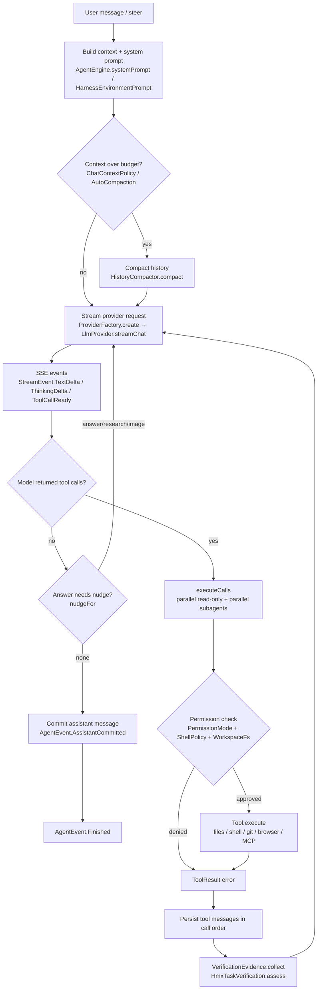
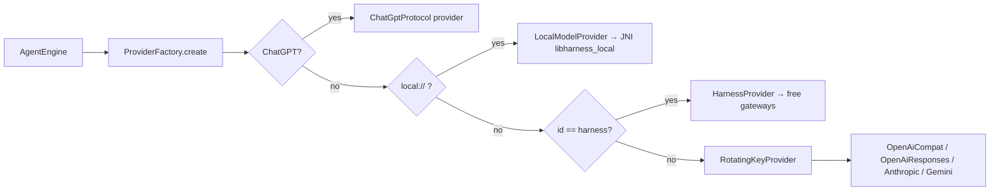

# HMXHARNESS — Internal Architecture

> Traced from source at `main` (`22e674e9`; later commits are documentation only). Class and file names below are real.
> Where the README's suggested sequence differs from the code, the difference is
> called out.

## 1. Layered structure

```
UI (Jetpack Compose, Material 3 Expressive, Liquid Glass)
  └── ViewModels / UI state (ui/chat/ChatViewModel.kt, ...)
        └── AppContainer composition root (HarnessApp.kt)
              ├── AgentEngine + ToolRegistry + permissions
              ├── LLM providers + fallback + routing
              ├── Workspaces, editor, terminal, Git
              ├── Room, DataStore, encrypted credentials
              ├── GitHub, MCP, browser, plugins, automation
              └── Linux toolchain, Shizuku/root/ADB, native JNI
```

`AppContainer` (`HarnessApp.kt`, class at line 72) wires singletons once per
process: `keys`, `settings`, `debugLog`, `pluginManager`, `nineRouter`,
`toolRegistry`-inputs, `linuxEnv`, `github`, `browser`, etc. `HarnessApp`
(`HarnessApp.kt:32`) installs `StorageGate` before any workspace is resolved and
creates the container in `onCreate`.

`MainActivity` (`MainActivity.kt:59`) is the single activity: `enableEdgeToEdge()`
and `setContent { ... }`. Navigation is one `NavHost` in `ui/AppNav.kt` with
about 21 destinations (`chat`, `terminal`, `files`, `changes`, `automation`,
`projects`, `project/{id}`, `build-test`, `settings`, `providers`, `skills`,
`stats`, `setup`, `my-ai`, ...).

## 2. End-to-end run flow (actual)

The real flow is a **loop**, not a one-pass pipeline. The `while (true)` loop is
in `AgentEngine.run` (`agent/AgentEngine.kt:463`).



### Step-by-step mapping

| Conceptual step | Actual implementation |
|---|---|
| **User input** | `ChatViewModel` sends a turn to `AgentEngine.run(...)` (`AgentEngine.kt:296`); steering messages are injected between rounds (`Steering`, `takeSteering`). |
| **Agent processing** | `AgentEngine.run` owns the coroutine, budget, retries, compaction and event emission. |
| **Planning** | Planning is **not a separate planner module**. `AgentMode.PLAN` (`AgentEngine.kt:51`) restricts tool schemas to read-only (`readOnlyOnly = mode == PLAN`, line 978). Task tracking is `TodoStore`/`todo_write` (`agent/TodoStore.kt`). The README's "dual planning" is not a distinct class — treat it as a UI/behaviour description, not an architecture component. |
| **Context construction** | `systemPrompt` (`AgentEngine.kt:2604`), `HarnessEnvironmentPrompt.kt`, `runtimeEnvironment` (line 2759), project config (`config/HarnessConfig.kt`), memory (`data/MemoryRepository.kt`), repo map (`repomap/`). |
| **Model interaction** | `ProviderFactory.create(config)` (`llm/Llm.kt:224`) selects a provider: ChatGPT → `chatgpt/`, local → `local/LocalModelProvider`, `harness` → `HarnessProvider`, else protocol provider wrapped in `RotatingKeyProvider`. Streaming is `Flow<StreamEvent>` over OkHttp SSE. |
| **Tool selection** | The model emits OpenAI-style tool calls; parsed as `StreamEvent.ToolCallReady` / `ToolCallBatch`. Schemas come from `ToolRegistry.schemas(...)` (`tools/Tool.kt:69`). |
| **Tool execution** | `executeCalls` (`AgentEngine.kt:1112`) runs `task` subagents concurrently, batches parallel read-only tools, and runs everything else sequentially. |
| **Permissions** | `executeWithPermission` / `performWithPermission` (`AgentEngine.kt:1477`, `1540`) gate by `PermissionMode` (`CONFIRM_ALL`, `CONFIRM_RISKY`, `FULL_AUTO`, `FULL_ACCESS`) with `ApprovalRequest` + `CompletableDeferred`. `ShellPolicy.denyReason` and `WorkspaceFs.resolve` enforce sandbox rules. |
| **File changes** | `tools/FileTools.kt`, `tools/PatchTools.kt`, `tools/FuzzyEdit.kt`; atomic writes, `CheckpointStore` for undo, `WorkspaceFileHistory` for before/after copies. |
| **Verification** | `VerificationEvidence.collect` (`agent/VerificationEvidence.kt`) scans shell results for recognized build/test/lint commands and marks earlier passes `STALE` after edits. `HmxTaskVerification.assess` (`hmx/HmxTaskVerification.kt`) turns checks into `VERIFIED / UNVERIFIED / FAILED / STALE / NO_CHECKS`; `ui/chat/components/VerificationCard.kt` renders it. |
| **Preview/result** | `AgentEvent` stream → `ChatViewModel` → Compose. Tool cards, diffs, rich replies, then `AgentEvent.Finished`. |

## 3. Important boundaries

- **UI does not do network/DB work directly.** `ui/` talks to ViewModels and
  `AppContainer` singletons.
- **Tool execution is policy-checked before touching the device or workspace.**
  `ShellPolicy` (denylist + containment), `WorkspaceFs` (`startsWith(rootPath)`),
  `PermissionMode`, and `StorageGate`.
- **`AppContainer` is the only composition root**; tests construct pieces
  directly.

## 4. Model layer



`ProviderConfig` (`llm/Llm.kt:51`) is `@Serializable`; `headers` are `@Transient`
so they never leak into exports. `ProviderType` (`Llm.kt:25`) has four wire
protocols. `FallbackProvider` and `FallbackPolicy` implement cross-provider
fallback. `ModelCatalog`, `ModelPrices`, `ModelsDev` provide model metadata and
pricing lookups.

## 5. Local inference

- `local/LocalNative.kt` declares `external` functions and loads
  `libharness_local` (`System.loadLibrary("harness_local")`).
- `app/src/main/cpp/local_model.cpp`, `local_chat.cpp`, `safetensors_import.cpp`
  implement inference, chat templating and Safetensors→GGUF conversion.
- `CMakeLists.txt` fetches **llama.cpp** with `FetchContent`, enables
  `GGML_BACKEND_DL`, and supports Vulkan GPU on `arm64-v8a`/`x86_64`; 32-bit ABIs
  get `local_unavailable.cpp` stubs.
- `local/DeviceTelemetry.kt` loads `libharness_device` for
  `neuralDevices()`.

## 6. Data layer

- Room database: `data/db/Database.kt`, `@Database` at line 832, version 27,
  14 entities (sessions, messages, projects, checkpoints, memory, ...) and 23
  migrations.
- Settings: `data/SettingsRepository.kt` over DataStore.
- Credentials: `data/KeyStoreManager.kt` — `EncryptedSharedPreferences` created
  with a `MasterKey` (`AES256_GCM`), key encryption `AES256_SIV`, value
  encryption `AES256_GCM`.
- Backups: `data/ChatBackup.kt` (`ChatBackupManager`, JSON chat export/import)
  and encrypted settings backup (`data/BackupEncryption.kt`).

## 7. Workspace and shell

- `workspace/WorkspaceFs.kt` resolves and canonicalizes paths and rejects
  anything outside the workspace root (`startsWith(rootPath)`).
- `data/env/ShellTierRouter.kt` chooses `ExecutionTier`: `TERMUX_SSH`, `ROOT`,
  `PRIVILEGED` (Shizuku), `APP_LINUX`, `TOYBOX`.
- `data/env/LinuxEnvironment.kt` bootstraps Termux packages (bash, git, python,
  node) with SHA-256 verification and ~15 mirrors.
- `tools/ShellTool.kt`, `tools/BgShell.kt` run commands and background jobs.

## 8. Browser

`browser/BrowserController.kt:175` drives a real `WebView`:
`navigate`, `click`, `type`, `scroll`, `back/forward`, `refresh`, `waitFor`,
`evalUser`, `screenshot`. `browser/WorkspacePathHandler.kt` serves workspace files
through `WebViewAssetLoader`. Agent tools wrap these methods
(`tools/BrowserTools.kt`, 14 tools).

## 9. MCP and plugins

- MCP: `tools/mcp/McpManager.kt`, `McpConnection.kt`, `McpTransport.kt`,
  `McpToolAdapter.kt`, `McpOAuth.kt` (OAuth 2.1 PKCE). Tools are merged into the
  run-scoped registry via `ToolRegistry.withExtra`.
- Plugins: `plugins/PluginManager.kt`, `PluginCatalog.kt`, `PluginStore.kt`,
  plus `config/PluginHooks.kt` (command/prompt hooks).

## 10. What the architecture is not

- Not a client/server app: there is no HMX backend; provider requests go from
  the device to the configured endpoint.
- Not a multi-module app: `:app` plus an optional `:local_gpu` dynamic feature.
- Not a web wrapper: `MainActivity` renders native Compose; the WebView exists
  for the agent browser and previews.
- Not a separate planner/executor process: planning and execution share one
  `AgentEngine` coroutine and tool registry.
