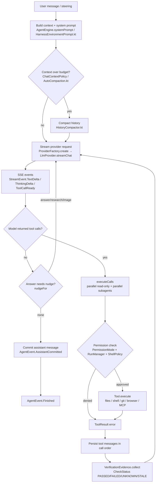
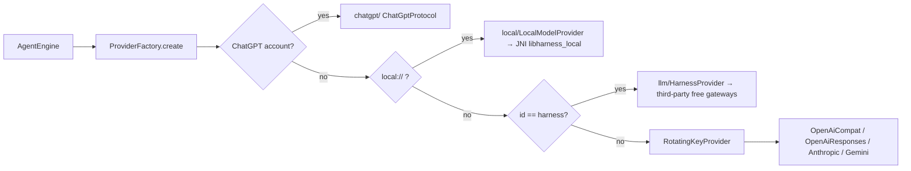

# HMXHARNESS — Internal Architecture

> Traced from source in the current repository. Paths are relative to
> `app/src/main/java/com/hmx/harness/` unless stated otherwise. This document
> describes the code as it exists today, not an aspirational design. Where a
> capability exists only in tests or in a UI object, that is stated explicitly.

## 1. Layered structure

```
UI (Jetpack Compose, Material 3 Expressive, HMX Liquid Glass)
  └── ViewModels / UI state (ui/chat/ChatViewModel.kt, ...)
        └── AppContainer composition root (HarnessApp.kt:72)
              ├── AgentEngine + RunManager + ToolRegistry + permissions
              ├── LLM providers + fallback + routing
              ├── Workspaces, editor, terminal, Git
              ├── Room, DataStore, encrypted credentials
              ├── GitHub, MCP, browser, plugins, automation
              └── Linux toolchain, Shizuku/root/ADB, native JNI
```

`HarnessApp.kt` installs `StorageGate` in `onCreate` (`HarnessApp.kt:32`, `:42`)
before any workspace is resolved, then creates `AppContainer` (`:72`) as the
single composition root for process-wide singletons: `keys`, `settings`,
`debugLog`, `pluginManager`, `nineRouter`, `linuxEnv`, `github`, `browser`, the
tool registry inputs, and others.

`MainActivity.kt` (`:59`) enables edge-to-edge (`:77`) and calls `setContent`
(`:98`). Navigation is a single `NavHost` in `ui/AppNav.kt` with roughly two
dozen destinations (`chat`, `terminal`, `files`, `changes`, `automation`,
`projects`, `project/{id}`, `build-test`, `settings`, `providers`, `skills`,
`stats`, `setup`, `my-ai`, ...).

## 2. End-to-end agent run flow

The flow is a **loop**, not a one-pass pipeline: `while (true)` in
`AgentEngine.run` (`agent/AgentEngine.kt:463`). `maxIterations` is a safety limit
(`:468`).



### Step-by-step mapping

| Conceptual step | Actual implementation |
|---|---|
| **User input** | `ChatViewModel` sends a turn to `AgentEngine.run` (`agent/AgentEngine.kt:296`); steering messages are injected between rounds (`agent/Steering.kt`, `takeSteering`). |
| **Agent processing** | `AgentEngine.run` owns the coroutine, context budget, retries, compaction and event emission. `RunManager` (`agent/RunManager.kt`) owns session state and approval requests (`approve` at `:1122`, `deny` at `:1128`, plus notification actions). |
| **Planning** | There is no separate planner module. `AgentMode.PLAN` restricts tool schemas to read-only (`readOnlyOnly = mode == AgentMode.PLAN`, `agent/AgentEngine.kt:978`). Task tracking uses `agent/TodoStore.kt` / `todo_write`. |
| **Context construction** | `systemPrompt`, `agent/HarnessEnvironmentPrompt.kt`, `config/HarnessConfig.kt`, `data/MemoryRepository.kt`, `repomap/`. |
| **Model interaction** | `ProviderFactory.create` (`llm/Llm.kt:208`, `:224`) selects a provider; streaming is `Flow<StreamEvent>` over OkHttp SSE (`llm/Llm.kt`). |
| **Tool selection** | The model emits OpenAI-style tool calls, parsed as `StreamEvent.ToolCallReady` / `ToolCallBatch`; schemas come from `ToolRegistry.schemas(...)` (`tools/Tool.kt`). |
| **Tool execution** | `executeCalls` (`agent/AgentEngine.kt:1112`) runs `task` subagents concurrently, batches parallel read-only tools, and runs the rest sequentially. |
| **Permissions (real gate)** | `PermissionMode` (`agent/AgentEngine.kt:42`: `CONFIRM_ALL`, `CONFIRM_RISKY`, `FULL_AUTO`, `FULL_ACCESS`) plus `RunManager.approve/deny` and notification actions; `tools/ShellPolicy.kt` applies a denylist and workspace containment; `workspace/WorkspaceFs.kt` canonicalises paths. |
| **File changes** | `tools/FileTools.kt`, `tools/PatchTools.kt`, `tools/FuzzyEdit.kt`; atomic writes, checkpoints and before/after history (`tools/FileHistoryTools.kt`, `data/CheckpointStore.kt`). |
| **Verification display** | `agent/VerificationEvidence.kt` records shell build/test/lint outcomes as `PASSED / FAILED / UNKNOWN` and flips earlier passes to `STALE` after later edits. `ui/chat/components/VerificationCard.kt` renders a verdict. |

### Important honesty note about the "verification gate"

`hmx/HmxTaskVerification.kt` defines `HmxVerificationLevel`, `HmxTaskVerification.assess`
and `canClaimCompletion()` (`:47`), plus `HmxApprovalPolicy` / `HmxRisk` (`:56`).
Current facts:

- `HmxTaskVerification.assess()` is called by `ui/chat/components/VerificationCard.kt`
  (`:48`) to compute the **displayed** verdict.
- `canClaimCompletion()` and `HmxApprovalPolicy` are referenced only by
  `app/src/test/java/com/hmx/harness/hmx/HmxTaskVerificationTest.kt`; a repo-wide
  search found **no runtime caller**.
- Therefore the agent loop is **not** blocked by this gate, and HMX approval
  policy does **not** classify commands at runtime. Do not claim "completion is
  gated by HMX verification" as a shipped feature. The real gating layers are
  `PermissionMode`, `RunManager.approve/deny`, notification actions and
  `tools/ShellPolicy.kt`. This is a documented gap, listed again in
  `HMXHARNESS_FEATURE_VERIFICATION.md` and
  `HMXHARNESS_CHALLENGES_AND_COSTS.md`.

## 3. Important boundaries

- **UI does not do network/DB work directly.** `ui/` talks to ViewModels and
  `AppContainer` singletons.
- **Tool execution is policy-checked before touching the device or workspace.**
  `ShellPolicy.denyReason`, `WorkspaceFs.resolve`, `PermissionMode` and
  `StorageGate` are independent checks; approval is an additional, not the only,
  gate.
- **`AppContainer` is the only composition root**; tests construct pieces
  directly.
- **No HMX backend.** Provider traffic goes from the device to the configured
  endpoint (`llm/Llm.kt`); there is no server module in `settings.gradle.kts`.

## 4. Model layer



`ProviderConfig` in `llm/Llm.kt` is `@Serializable`, with `headers` marked
`@Transient` so they are not exported. `ProviderType` covers the four wire
protocols. `llm/FallbackProvider.kt` and `llm/FallbackPolicy.kt` implement
cross-provider fallback; `llm/RotatingKeyProvider.kt` rotates keys. Metadata and
pricing helpers live in `llm/ModelCatalog.kt`, `llm/ModelPrices.kt` and
`llm/ModelsDev.kt`. 9Router local routing is in `router/NineRouterManager.kt`
and `router/NineRouterNodeRuntime.kt`. The built-in `harness` provider
(`llm/HarnessProvider.kt`) routes to third-party public gateways; it is **not**
a model hosted by HMXHARNESS.

## 5. Local inference (CPU shipped, GPU opt-in)

- `local/LocalNative.kt` declares `external` functions and loads
  `libharness_local` via `System.loadLibrary("harness_local")`.
- `app/src/main/cpp/local_model.cpp`, `local_chat.cpp` and
  `safetensors_import.cpp` implement inference, chat templating and
  Safetensors→GGUF conversion. `app/src/main/cpp/CMakeLists.txt` fetches
  llama.cpp with `FetchContent`; 32-bit ABIs use `local_unavailable.cpp` stubs.
- `local/LocalAccelerationPolicy.kt` defines `LocalBackend` (`AUTO`, `CPU`,
  `GPU`) and `useGpu(experimental, preference, available)`: GPU is used only
  when `SettingsRepository.localModelExperimental` is true — its default is
  `false` (`data/SettingsRepository.kt:234`, `:596`). CPU GGUF inference is the
  shipped path; Vulkan GPU execution is **experimental, opt-in and not
  hardware-verified in this repository**.
- `local/DeviceTelemetry.kt` loads `libharness_device` for device capability
  information.

## 6. Data layer

- Primary Room database: `data/db/Database.kt` (`@Database` at `:832`), schema
  **version 27**, **14** `@Entity` classes and **23** migrations (sessions,
  messages, projects, checkpoints, memory, ...). A separate debug-log database
  exists for diagnostics.
- Settings: `data/SettingsRepository.kt` over DataStore preferences.
- Credentials: `data/KeyStoreManager.kt` uses `EncryptedSharedPreferences` with
  an Android Keystore `AES256_GCM` master key (key encryption `AES256_SIV`,
  value encryption `AES256_GCM`).
- Backups: `data/ChatBackup.kt` (JSON chat export/import) and
  `data/BackupEncryption.kt` (encrypted settings backup).
- Memory: `data/MemoryRepository.kt` with global/project/chat scopes, categories,
  pinning and search.

## 7. Workspace and shell

- `workspace/WorkspaceFs.kt` resolves and canonicalises paths and rejects paths
  outside the workspace root; SAF workspaces are handled in `workspace/`.
- `data/env/ShellTierRouter.kt` selects an `ExecutionTier`: `TERMUX_SSH`,
  `ROOT`, `PRIVILEGED` (Shizuku), `APP_LINUX`, `TOYBOX`.
- `data/env/LinuxEnvironment.kt` bootstraps Termux packages (bash, git, python,
  node) with SHA-256 verification and mirror fallback;
  `data/env/PackageMirrors.kt` holds the mirror list.
- `tools/ShellTool.kt` and `tools/BgShell.kt` run foreground and background
  commands; `tools/ShellPolicy.kt` applies the denylist/containment checks.
- Privileged access helpers: `data/env/ShizukuManager.kt`,
  `data/env/RootManager.kt`, `data/env/DhizukuManager.kt`, and the ADB transport
  in `data/env/adb/` (several files note "Adapted from Shizuku (Apache 2.0)").

## 8. Browser, MCP and plugins

- `browser/BrowserController.kt` drives a real `WebView`: navigate, click,
  type, scroll, back/forward, refresh, `waitFor`, `evalUser` and screenshot.
  `browser/WorkspacePathHandler.kt` serves workspace files through
  `WebViewAssetLoader`; agent-facing tools are in `tools/BrowserTools.kt`.
- MCP: `tools/mcp/McpManager.kt`, `McpConnection.kt`, `McpTransport.kt`,
  `McpToolAdapter.kt` and `McpOAuth.kt` (OAuth 2.1 PKCE). Tools are merged into
  the run-scoped registry via `ToolRegistry.withExtra` (`tools/Tool.kt`). The
  static headers in the MCP config are plaintext; see `SECURITY.md`.
- Plugins: `plugins/PluginManager.kt`, `plugins/PluginCatalog.kt`,
  `plugins/PluginStore.kt` and hooks in `config/PluginHooks.kt`.
- CodeGraph is a vendored bundle with local fixes in
  `data/env/CodeGraphPatches.kt`, exposed through `tools/CodeGraphTools.kt`
  and `data/env/CodeGraphMcp.kt`.

## 9. UI and theming

- `ui/AppNav.kt` owns navigation; `ui/chat/ChatViewModel.kt` holds chat state;
  `ui/chat/components/VerificationCard.kt` renders verification outcomes.
- `ui/liquidglass/GlassQuality.kt` defines `GlassTier.LOW / MID / HIGH`,
  `profileFor` and `detectGlassTier`; tiers are chosen from low-RAM/core/GLES
  signals. Tokens and components live in `GlassTokens.kt`,
  `LiquidGlassPalette.kt`, `LiquidGlassComponents.kt` and
  `LiquidGlassModifiers.kt`.
- Tier resolution has a unit test (`app/src/test/java/com/hmx/harness/ui/theme/HarnessGlassModeTest.kt`).
  The instrumented `app/src/androidTest/java/com/hmx/harness/ui/liquidglass/LiquidGlassScreenshotTest.kt`
  captures screenshots but has **no pixel assertions** and wraps screens in
  `runCatching { }.onFailure { Log.w }`; it is therefore not a gating visual test.

## 10. What the architecture is not

- Not a client/server app: no HMX backend exists.
- Not a web wrapper: `MainActivity.kt` renders native Compose; the WebView is
  an agent tool and preview surface.
- Not a multi-module app: `:app` plus an optional `:local_gpu` dynamic feature
  included only with `-Pdistribution=play` (`settings.gradle.kts`).
- Not a separate planner/executor process: planning and execution share one
  `AgentEngine` coroutine and tool registry.
- Not a runtime-verification-gated agent: see the honesty note in §2.
