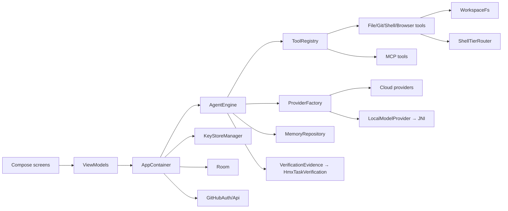

# HMXHARNESS — Custom-Built Components

> Classification:
> **A** = developed from scratch · **B** = custom implementation on third-party
> libraries · **C** = third-party integration · **D** = standard framework
> functionality.
>
> **Author origin** is essential for honesty. This repository is a derivative of
> AndroidHarness (MIT). "Upstream" means the component was preserved/adapted from
> AndroidHarness; "HMX" means it was added or substantially rewritten in this
> project's history. Do not present upstream modules as HMX-original work.

## 1. HMX-original components (added in this project's history)

| Component | Files | Class | Origin | What it does | Communicates with |
|---|---|---|---|---|---|
| Liquid Glass material system | `ui/liquidglass/GlassTokens.kt`, `LiquidGlassPalette.kt`, `LiquidGlassComponents.kt`, `LiquidGlassModifiers.kt`, `GlassQuality.kt` | tokens, `profileFor`, `detectGlassTier`, `LocalHmxGlassBackdrop`, `hmxGlass` modifiers | **HMX (B)** on PrismalAGSL/Backdrop | Defines the app-wide glass tokens and three quality tiers (`LOW/MID/HIGH`), then renders glass via PrismalAGSL backdrop blur/refraction; components share one ambient backdrop. | `ui/theme/Theme.kt`, every Compose screen |
| GitHub Device Flow **connection card** | `ui/settings/ConnectedAccountsSection.kt` (new, 183 lines); `github/GitHubAuth.kt` (modified, +48/−14) | `ConnectedAccountsSection` | **HMX (A)** UI on **upstream** auth | Shows the device code, verification URL, busy/polling state and PAT fallback inside Settings, and exposes auth state to Compose. **The flow itself is upstream** (see §2). | `GitHubAuth`, `KeyStoreManager`, `ui/settings/` |
| HMX verification gate | `hmx/HmxTaskVerification.kt` | `HmxTaskVerification`, `HmxVerificationLevel` | **HMX (A)** | Converts recorded checks into `VERIFIED/UNVERIFIED/FAILED/STALE/NO_CHECKS` and decides whether completion may be claimed. | `agent/VerificationEvidence.kt`, `ui/chat/components/VerificationCard.kt` |
| HMX hybrid approval policy | `hmx/HmxTaskVerification.kt` | `HmxApprovalPolicy`, `HmxRisk` | **HMX (A)** | Classifies shell commands as `SAFE / APPROVAL_REQUIRED / PROHIBITED` using regex rules. | `AgentEngine` permission flow (used alongside upstream policy) |
| Cloud CI/CD | `.github/workflows/android-ci.yml`, `android-release.yml`, `android-visual-qa.yml`, `lint-baseline.yml` | — | **HMX (A)** | Tests, lint, debug/release APKs, artifact upload, Client ID injection, emulator visual QA and glass performance matrices (the earlier separate glass QA/perf workflows were consolidated into `android-visual-qa.yml` in `53987768`). | GitHub Actions |
| Lint baseline infrastructure | `app/lint-baseline.xml`, `.github/workflows/lint-baseline.yml` | — | **HMX (A)** | Freezes inherited lint findings so new regressions fail CI. | Android lint |
| Rebrand / identity | `app/build.gradle.kts`, `AndroidManifest.xml`, 734 renamed/edited Kotlin files, `README.md`, `SECURITY.md`, `CONTRIBUTING.md`, issue templates | — | **HMX (A)** | `com.hmx.harness` identity, deep-link scheme, removal of Donate/Discord UI, rewritten open-source docs. | Whole app |
| Two added translatable strings | `app/src/main/res/values-*/strings.xml` | — | **HMX (A)** | Added the GitHub Device Flow card strings across all locales. **The 21 locales themselves are upstream** (`6243c2c7`, `dc3e4e57`). | Settings |
| Expo/audit documentation | `docs/`, `docs/audits/`, `docs/expo/` | — | **HMX (A)** | Technical/security/build/audit reports. | — |

## 2. Inherited upstream engine (preserved, not HMX-authored)

These are core to the app but originate from AndroidHarness. Present them as
"the agent engine used by the app", not as newly invented technology.

| Component | Files | Class | Classification | What it does |
|---|---|---|---|---|
| Agent loop / run manager | `agent/AgentEngine.kt`, `agent/RunManager.kt` | `AgentEngine`, `RunManager` | B (custom app code) | Multi-round model→tool→result loop, budgets, retries, compaction, events. |
| Context policy / compaction | `agent/ChatContextPolicy.kt`, `AutoCompaction.kt`, `HistoryCompactor.kt`, `ContextHygiene.kt`, `ContextOverflow.kt` | — | A/B | Token budgeting, auto-compaction, image stripping, overflow recovery. |
| Subagents | `agent/SubagentRuns.kt`, `SubagentConfiguration.kt`, `SubagentModelResolver.kt`; `AgentEngine.runSubagent` | `SubagentRuns` | B | `task` tool spawns read-only or action subagents, runs batches concurrently, folds results back. |
| Verification evidence | `agent/VerificationEvidence.kt` | `VerificationEvidence`, `CheckStatus` | A | Recognizes build/test/lint shell commands and marks stale after edits. |
| GitHub Device Flow auth | `github/GitHubAuth.kt` (`startSignIn`, device-code polling) | `GitHubAuth`, `GitHubDeviceCode`, `GitHubCredential` | A (upstream) | Requests a device code, polls `/login/oauth/access_token` handling `authorization_pending`/`slow_down`/`expired_token`, refreshes via `offline_access`, PAT fallback. **Introduced upstream in `2207914579` (2026-10-09), before the rebrand.** |
| GitHub repos / PRs | `github/GitHubRepository.kt`, `GitHubPullRequests.kt`, `GitChangeTree.kt` | — | A (upstream) | Repository import, change tree, PR publishing. |
| 21-language localization | `app/src/main/res/values-*` | — | A (upstream) | 21 `values-*` locales added upstream on 2026-11-19 (`6243c2c7`, `dc3e4e57`). |
| Steering / queue / questions | `agent/Steering.kt`, `QuestionAutoContinue.kt`, `AskUserOptions.kt` | — | A | Inject messages between rounds, queue follow-ups, staged question cards. |
| Memory | `data/MemoryRepository.kt`, `agent/MemoryNotes.kt`, `MemoryTopics.kt` | `MemoryRepository` | B (Room) | Global/project/chat memory with scopes, categories, pinning, search. |
| Streaming retry / failover | `agent/StreamRetrier.kt`, `RetryPolicy.kt`, `llm/FallbackProvider.kt`, `FallbackPolicy.kt`, `RotatingKeyProvider.kt` | — | A/B | Retry transient failures, fail over between providers/keys. |
| Skills | `skills/SkillStore.kt`, `SkillParser.kt`, `SkillVariables.kt` | `SkillStore` | A | Load `SKILL.md` definitions, variables and assets. |
| Repo map / CodeGraph | `repomap/RepoMapGenerator.kt`, `RepoSymbolExtractor.kt`; `data/env/CodeGraphManager.kt`, `CodeGraphMcp.kt` | `RepoMapCache`, `CodeGraphManager` | B/C | Offline symbol map and CodeGraph CLI/MCP integration. |
| Cave-man reply modes | `caveman/CavemanPolicy.kt` | `CavemanPolicy`, `CavemanIntensity` | A | Terse reply styles applied to system prompts. |
| Live Mode | `agent/LiveMode.kt` | `LiveMode`, `LiveModeAccess` | A | Voice conversation mode with tool access levels. |
| Plugin hooks | `config/PluginHooks.kt`, `config/HarnessConfig.kt` | `ConfigPlugin`, `ConfigCommandHook` | A/B | Command/prompt hooks on run events. |

## 3. Tools (custom app modules)

The registry is assembled in `tools/Tool.kt` (`ToolRegistry.default`). It
declares ~83 tool entries including conditional browser/MCP/automation tools.
Key groups:

| Group | Files | Examples | Origin |
|---|---|---|---|
| Files | `FileTools.kt`, `PatchTools.kt`, `FuzzyEdit.kt`, `FileHistoryTools.kt` | `read_file`, `write_file`, `edit_file`, `apply_patch`, `search_files`, `grep`, `file_history` | Upstream + HMX additions |
| Shell | `ShellTool.kt`, `BgShell.kt`, `ShellPolicy.kt` | `shell`, `shell_background`, `bg_list` | Upstream |
| Git | `GitTools.kt` | `git_status`, `git_diff`, `git_commit`, `git_push`, `git_pull` | Upstream |
| GitHub | `GitHubTools.kt`, `GitHubPullRequestTool.kt` | repos, issues, PRs, commits | Upstream/HMX |
| Browser | `BrowserTools.kt` (14 tools) | `browser_navigate`, `browser_click`, `browser_eval` | Upstream |
| Web research | `SearchBackends.kt`, `SearchProviders.kt`, `TavilyPageReader.kt`, `WebSearchText.kt` | `web_search`, `web_fetch` | Upstream |
| Memory / chat recall | `MemoryTools.kt`, `UniversalMemoryTools.kt`, `ChatRecallTools.kt` | `remember`, `recall`, `search_chats` | Upstream |
| CodeGraph | `CodeGraphTools.kt` | `codegraph_explore`, `codegraph_impact` | Upstream |
| Settings / plugins | `AppSettingsTools.kt`, `AppPluginsTool.kt` | `app_settings_find/change`, plugin management | Upstream |
| Automation / reminders | `AutomationTools.kt`, `ReminderTools.kt` | `automation_create/list/manage` | Upstream |
| Subagents | `SubagentTools.kt`, `SubagentControlTools.kt` | `task` | Upstream |
| MCP | `tools/mcp/McpToolAdapter.kt` | dynamic tools | Upstream |

## 4. Third-party integrations (C) — do not call these custom

| Integration | Library/API | Evidence |
|---|---|---|
| Model providers | OpenAI/Anthropic/Gemini APIs | `llm/*Provider.kt` |
| Local inference | **llama.cpp** (native) | `app/src/main/cpp/CMakeLists.txt` |
| Liquid Glass rendering | **PrismalAGSL**, **kyant0 Backdrop** | `libs.versions.toml` |
| Code editor | **sora-editor** | `libs.versions.toml`, `ui/files/` |
| Privileged shell | **Shizuku**, **libsu**, **Dhizuku** | `data/env/` |
| Web search | Brave, Tavily, Serper, Linkup, Jina, LangSearch, SerpApi, Firecrawl, Marginalia, keyless engines | `tools/SearchProviders.kt` |
| Voice | Edge TTS, Groq, OpenAI, ElevenLabs, Deepgram, Cartesia, AssemblyAI | `data/audio/` |
| Telegram | Bot API | `telegram/TelegramBotClient.kt` |
| 9Router | external node runtime/CLI | `router/` |
| CodeGraph | external `codegraph` CLI/MCP | `data/env/CodeGraphManager.kt` |
| SSH | JSch | `app/build.gradle.kts` |
| Termux packages | Termux repositories | `data/env/LinuxEnvironment.kt` |

## 5. Standard framework functionality (D)

Room, DataStore, WorkManager, Navigation Compose, WebView, Android Keystore,
BiometricPrompt, NotificationManager, Foreground services, `WebViewAssetLoader`,
`JavascriptEngine`. These are configured by the app, not reimplemented.

## 6. Component communication summary

## 7. Claims to avoid

- "We built an AI model" — no training code exists; the app uses pre-trained
  models via APIs or llama.cpp.
- "We built Shizuku/Termux/llama.cpp/sora-editor" — these are third-party.
- "The agent engine is entirely our own" — it is preserved upstream code with
  HMX additions.
- "We built GitHub Device Flow" — the flow is upstream (`2207914579`); HMX built
  the Connected Accounts card and the CI Client-ID injection.
- "We translated the app into 21 languages" — the locales are upstream; HMX
  added two strings to them.
- "Liquid Glass is our own GPU renderer" — rendering primitives come from
  PrismalAGSL; the token/tier system is custom.
