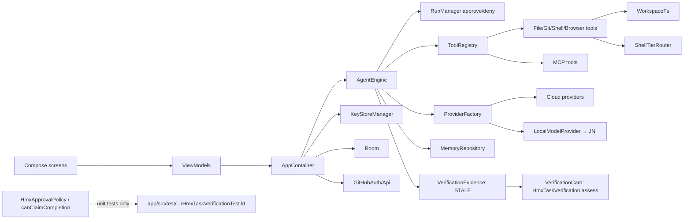

# HMXHARNESS — Custom-Built Components and Provenance

> Paths are relative to `app/src/main/java/com/hmx/harness/` unless stated
> otherwise. This document separates **HMXHARNESS additions**, **inherited
> upstream AndroidHarness code**, **adapted/vendored components** and
> **third-party libraries**. HMXHARNESS is an MIT-licensed derivative of
> AndroidHarness by Sanuu7; `LICENSE` preserves `Copyright (c) 2026 Sanuu7`.
>
> **Provenance nuance:** explicit per-file upstream attribution headers are
> rare in this tree. Do not claim "all engine code is upstream" or "all code is
> HMX-original". Provenance is established at component level through the
> README attribution section, license notices, and the few files that carry
> explicit adaptation notes. The current repository is a fresh migration; old
> Git history is absent and no historical commit hashes are cited here.

## Classification key

- **A** — original code written for this project.
- **B** — custom implementation built on third-party libraries.
- **C** — third-party integration or adapted/vendored component.
- **D** — standard Android framework functionality configured by the app.

## 1. HMXHARNESS additions

| Component | Files | Origin | What it does | Communicates with |
|---|---|---|---|---|
| Liquid Glass material system | `ui/liquidglass/GlassTokens.kt`, `LiquidGlassPalette.kt`, `LiquidGlassComponents.kt`, `LiquidGlassModifiers.kt`, `GlassQuality.kt` | **HMX (B)** on PrismalAGSL + kyant0 Backdrop | App-wide glass tokens, three quality tiers (`LOW/MID/HIGH`, `detectGlassTier`, `profileFor`) and wrappers used by Compose screens. Rendering primitives are third-party, not HMX-authored. | `ui/theme/Theme.kt`, Compose screens |
| HMX verification verdict object | `hmx/HmxTaskVerification.kt` (`HmxVerificationLevel`, `HmxTaskVerification.assess`) | **HMX (A)** | Converts recorded checks into `VERIFIED / UNVERIFIED / FAILED / STALE / NO_CHECKS` **for display** in chat. The comment at `:9` acknowledges that upstream already recorded build/test/lint results. | `agent/VerificationEvidence.kt`, `ui/chat/components/VerificationCard.kt` |
| HMX approval policy objects (test-only) | `hmx/HmxTaskVerification.kt` (`HmxApprovalPolicy`, `HmxRisk`, `canClaimCompletion()` at `:47`) | **HMX (A)** | Defines `SAFE / APPROVAL_REQUIRED / PROHIBITED` rules and a completion predicate. **Referenced only by `app/src/test/java/com/hmx/harness/hmx/HmxTaskVerificationTest.kt`; no runtime caller exists.** Not wired into the agent loop — see §6. | unit tests only |
| GitHub Connected Accounts card | `ui/settings/ConnectedAccountsSection.kt` | **HMX (A)** UI over **upstream** `github/GitHubAuth.kt` | Shows device code, verification URL, busy/polling state and PAT fallback in Settings. The Device Flow implementation itself is upstream. | `GitHubAuth`, `data/KeyStoreManager.kt` |
| Cloud CI configuration | `.github/workflows/android-ci.yml`, `android-release.yml`, `android-visual-qa.yml`, `lint-baseline.yml` | **HMX (A)** | Unit tests, lint, debug + release APKs, APK verification, artifact upload, visual-QA screenshots. Current green run: `45338701934`; artifact `hmxharness-apks` id `14898111209` (110,461,001 bytes). | GitHub Actions |
| Lint baseline infrastructure | `app/lint-baseline.xml`, `.github/workflows/lint-baseline.yml` | **HMX (A)** | Freezes inherited lint findings so new regressions are visible; `lintDebug` passes in CI. | Android lint |
| Project identity and docs | `app/build.gradle.kts`, `AndroidManifest.xml`, `README.md`, `LICENSE`, `SECURITY.md`, `PRIVACY.md`, issue/PR templates, `docs/expo/` | **HMX (A)** | `com.hmx.harness` identity, deep-link scheme, honest upstream attribution and Expo-ready documentation. | whole repository |

**Important limitation.** The HMX verification and approval objects are often
described as a "gate", but only `HmxTaskVerification.assess()` is used at
runtime, and only to render a card. `canClaimCompletion()` and
`HmxApprovalPolicy` are unit-tested but unused by `agent/AgentEngine.kt`. Real
approval is implemented by `PermissionMode` (`agent/AgentEngine.kt:42`),
`RunManager.approve/deny` (`agent/RunManager.kt:1122`, `:1128`) with notification
actions, and the denylist/containment checks in `tools/ShellPolicy.kt` and
`workspace/WorkspaceFs.kt`.

## 2. Inherited upstream AndroidHarness components

These are core to the app but were inherited from the MIT-licensed upstream
project. Present them as "the agent engine used by the app", not as newly
invented HMX technology.

| Component | Files | What it does |
|---|---|---|
| Agent loop / run manager | `agent/AgentEngine.kt`, `agent/RunManager.kt` | Multi-round model → tool → result loop (`AgentEngine.kt:463`), budgets, retries, compaction, events, approval state. |
| Context policy / compaction | `agent/ChatContextPolicy.kt`, `AutoCompaction.kt`, `HistoryCompactor.kt`, `ContextHygiene.kt`, `ContextOverflow.kt` | Token budgeting, auto-compaction and overflow recovery. |
| Verification evidence | `agent/VerificationEvidence.kt` (`CheckStatus`, `VerificationEvidence.collect`) | Recognises build/test/lint shell results (`PASSED / FAILED / UNKNOWN`) and marks earlier passes `STALE` after edits. |
| Subagents | `agent/SubagentRuns.kt`, `SubagentConfiguration.kt`, `SubagentModelResolver.kt`, `AgentEngine.runSubagent` | `task` tool spawns read-only or action subagents and folds results back. |
| Steering / queue / questions | `agent/Steering.kt`, `QuestionAutoContinue.kt`, `agent/AskUserOptions.kt` | Inject messages between rounds, queue follow-ups and staged question cards. |
| GitHub Device Flow | `github/GitHubAuth.kt` (`startSignIn`, device-code polling, `offline_access` refresh, PAT fallback) | OAuth App Device Flow: `/login/device/code` → poll `/login/oauth/access_token` with `authorization_pending` / `slow_down` / `expired_token` handling. |
| GitHub repos / PRs | `github/GitHubRepository.kt`, `GitHubPullRequests.kt`, `GitChangeTree.kt` | Repository import, change trees and PR publishing. |
| Memory | `data/MemoryRepository.kt`, `agent/MemoryNotes.kt`, `MemoryTopics.kt` | Scoped memory with categories, pinning and search. |
| Streaming retry / failover | `agent/StreamRetrier.kt`, `RetryPolicy.kt`, `llm/FallbackProvider.kt`, `FallbackPolicy.kt`, `RotatingKeyProvider.kt` | Retry transient failures and fail over between providers/keys. |
| Skills / Live Mode / reply styles | `skills/SkillStore.kt`, `agent/LiveMode.kt`, `caveman/CavemanPolicy.kt` | `SKILL.md` loading, voice conversation mode, terse reply styles. |
| Localization | `app/src/main/res/values-*` (21 locales) and base `values/` with 1,129 strings | Translated UI; the locales are inherited upstream, not HMX translations. |

## 3. Adapted and vendored components

| Component | Files | Origin note |
|---|---|---|
| ADB transport | `data/env/adb/AdbClient.kt`, `AdbKey.kt`, `AdbMdns.kt`, `AdbPairingClient.kt`, `PairingContext.kt` | Files state "Adapted from Shizuku (Apache 2.0)"; preserve that notice. |
| CodeGraph | `data/env/CodeGraphManager.kt`, `data/env/CodeGraphMcp.kt`, `data/env/CodeGraphPatches.kt` | Vendored CodeGraph release with HMX-authored idempotent patches (`CodeGraphBundlePatches.VERSION = 12`) applied to the extracted bundle. |
| Caveman skill | `caveman/CavemanPolicy.kt`, `app/src/main/assets/licenses/caveman.txt` | Reply rules and skills adapted from Julius Brussee's MIT-licensed caveman project; its copyright notice is preserved in the asset. |
| Native inference | `app/src/main/cpp/CMakeLists.txt`, `local_model.cpp` | llama.cpp is fetched at build time, not written by this project. |

## 4. Tool registry (custom app modules)

The registry is assembled in `tools/Tool.kt` (`ToolRegistry.default`) with roughly
80 entries, including conditional browser/MCP/automation tools.

| Group | Files | Examples | Origin |
|---|---|---|---|
| Files | `tools/FileTools.kt`, `PatchTools.kt`, `FuzzyEdit.kt`, `FileHistoryTools.kt` | `read_file`, `write_file`, `edit_file`, `apply_patch`, `search_files`, `grep` | Upstream core, HMX additions |
| Shell | `tools/ShellTool.kt`, `BgShell.kt`, `ShellPolicy.kt` | `shell`, `shell_background`, `bg_list` | Upstream |
| Git / GitHub | `tools/GitTools.kt`, `GitHubTools.kt`, `GitHubPullRequestTool.kt` | status, diff, commit, push, repos, issues, PRs | Upstream + HMX additions |
| Browser | `tools/BrowserTools.kt` | `browser_navigate`, `browser_click`, `browser_eval` | Upstream |
| Web research | `tools/SearchProviders.kt`, `SearchBackends.kt`, `TavilyPageReader.kt`, `WebSearchText.kt` | `web_search`, `web_fetch` | Upstream |
| Memory / chat recall | `tools/MemoryTools.kt`, `UniversalMemoryTools.kt`, `ChatRecallTools.kt` | `remember`, `recall`, `search_chats` | Upstream |
| CodeGraph | `tools/CodeGraphTools.kt` | `codegraph_explore`, `codegraph_impact` | Vendored + HMX patches |
| Settings / plugins | `tools/AppSettingsTools.kt`, `AppPluginsTool.kt` | app settings find/change, plugin management | Upstream |
| Automation / reminders | `tools/AutomationTools.kt`, `ReminderTools.kt` | `automation_create/list/manage` | Upstream |
| Subagents / MCP | `tools/SubagentTools.kt`, `tools/mcp/McpToolAdapter.kt` | `task`, dynamic MCP tools | Upstream |

## 5. Third-party integrations (C) — do not call these custom

| Integration | Library / API | Evidence |
|---|---|---|
| Model providers | OpenAI-compatible, Responses, Anthropic, Gemini APIs | `llm/OpenAiCompatProvider.kt`, `OpenAiResponsesProvider.kt`, `AnthropicProvider.kt`, `GeminiProvider.kt` |
| Local inference | **llama.cpp** (native) | `app/src/main/cpp/CMakeLists.txt` |
| Glass rendering | **PrismalAGSL**, **kyant0 Backdrop** | `gradle/libs.versions.toml`, `ui/liquidglass/LiquidGlassModifiers.kt` |
| Code editor | **sora-editor** | `gradle/libs.versions.toml`, `ui/files/` |
| Privileged shell | **Shizuku**, **libsu**, **Dhizuku**, Wireless ADB | `data/env/ShizukuManager.kt`, `RootManager.kt`, `DhizukuManager.kt`, `data/env/adb/` |
| Web search | Brave, Tavily, Serper, Linkup, Jina, LangSearch, SerpApi, Firecrawl, Marginalia, keyless engines | `tools/SearchProviders.kt` |
| Voice | Edge TTS, Groq, OpenAI, ElevenLabs, Deepgram, Cartesia, AssemblyAI | `data/audio/` |
| Telegram | Bot API | `telegram/TelegramBotClient.kt`, `TelegramGateway.kt` |
| 9Router | external node runtime/CLI | `router/NineRouterManager.kt` |
| SSH | JSch | `app/build.gradle.kts`, `data/env/` |

Standard framework functionality (**D**) — Room, DataStore, WorkManager,
Navigation Compose, WebView, Android Keystore, BiometricPrompt, notifications,
foreground services and `WebViewAssetLoader` — is configured by the app, not
reimplemented.

## 6. Component communication summary

## 7. Claims to avoid

- **"We built an AI model."** No training code exists; models come from provider
  APIs or llama.cpp.
- **"We built Shizuku / Termux / llama.cpp / sora-editor / PrismalAGSL."** These
  are third-party integrations; some ADB files are explicitly adapted from
  Shizuku (Apache 2.0).
- **"The agent engine is entirely our own" / "all engine code is upstream."**
  Provenance is per component; explicit headers are rare.
- **"We built GitHub Device Flow / translated the app into 21 languages."** Both
  are inherited upstream; HMX added the Settings card, CI wiring and
  documentation.
- **"Liquid Glass is our GPU renderer."** The token/tier system is custom;
  rendering primitives come from PrismalAGSL and Backdrop.
- **"Verification/approval is enforced by the HMX gate at runtime."** False:
  `canClaimCompletion()` and `HmxApprovalPolicy` are test-only; the real gates are
  `PermissionMode`, `RunManager.approve/deny` and `ShellPolicy`.
- **"Vulkan GPU inference is shipped and verified."** CPU GGUF is the shipped
  path; GPU requires `localModelExperimental = true`
  (`data/SettingsRepository.kt:234`), is decided by
  `local/LocalAccelerationPolicy.kt`, and is not hardware-verified here.
- **"Visual correctness is automatically verified."** The instrumented glass
  screenshot test has no pixel assertions and swallows failures; see
  `HMXHARNESS_FEATURE_VERIFICATION.md`.
